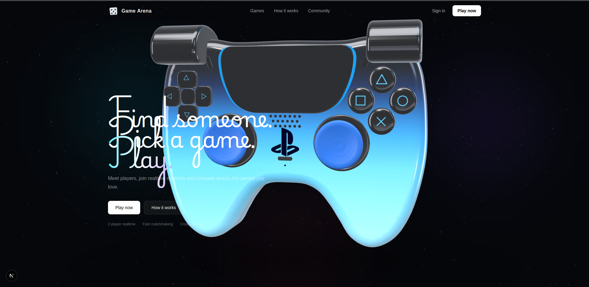

# Game Arena

<p align="center">
  <strong>A realtime multiplayer gaming platform.</strong>
</p>

<p align="center">
  Discover games, find players, join matches and build communities.
</p>

<p align="center">
  <a href="#features">Features</a>
  ·
  <a href="#tech-stack">Tech Stack</a>
  ·
  <a href="#development">Development</a>
  ·
  <a href="#roadmap">Roadmap</a>
</p>

---



## About

**Game Arena** is a modern multiplayer gaming platform designed around realtime game discovery, matchmaking, communities and interactive game experiences.

The project combines a responsive web interface with lightweight 3D experiences and a realtime-oriented architecture.

The current release focuses on establishing the product foundation: the interface, visual system, navigation, game discovery, community experience, authentication flows and matchmaking workflow.

Realtime services and persistent backend infrastructure will be introduced progressively.

## Features

### Game Discovery

Browse games through a dedicated discovery experience with:

* Search
* Categories
* Game cards
* Live player indicators
* Interactive 3D elements

### Multiplayer Workflow

Game Arena includes a visual matchmaking workflow built with React Flow.

```text
Choose Game
     ↓
Matchmaking
     ↓
Player Found
     ↓
Realtime Match
```

The workflow is node-based rather than relying on manually positioned SVG connections, allowing it to evolve as the multiplayer architecture grows.

### Community

The community experience provides a foundation for:

* Discovering gaming communities
* Seeing players currently online
* Following recent activity
* Exploring social spaces
* Connecting players around games

### Authentication

The frontend currently includes the complete initial authentication flow:

* Sign in
* Sign up
* Forgot password
* Reset password
* Email verification

These interfaces are currently frontend-only.

### Interactive 3D

Three.js is used throughout the platform to provide interactive visual elements without turning the interface into a purely decorative 3D experience.

Current objects include:

* Dice
* Game controller
* 3D portrait
* Particle-based game universe

## Tech Stack

### Core

| Technology   | Purpose                     |
| ------------ | --------------------------- |
| Next.js 16   | Application framework       |
| React        | UI                          |
| TypeScript   | Type safety                 |
| Bun          | Package manager and runtime |
| Tailwind CSS | Styling                     |
| Three.js     | 3D experiences              |

### UI & Interaction

| Technology  | Purpose                |
| ----------- | ---------------------- |
| shadcn/ui   | Reusable UI primitives |
| Hugeicons   | Interface icons        |
| React Flow  | Interactive workflows  |
| next-themes | Theme management       |

## Architecture

The project follows a component-oriented architecture designed around reusable product experiences.

```text
src/
├── app/
│   ├── community/
│   ├── forgot-password/
│   ├── games/
│   ├── how-it-works/
│   ├── privacy/
│   ├── reset-password/
│   ├── sign-in/
│   ├── sign-up/
│   ├── terms/
│   ├── verify-email/
│   ├── layout.tsx
│   └── page.tsx
│
├── components/
│   ├── controller-viewer.tsx
│   ├── dice.tsx
│   ├── game-universe-background.tsx
│   ├── legal-page.tsx
│   ├── match-workflow.tsx
│   ├── navbar.tsx
│   └── portrait-viewer.tsx
│
└── lib/
    └── controller-config.ts
```

The goal is to keep product pages, visual systems and interactive objects independent and reusable.

## 3D System

Game Arena uses reusable Three.js components rather than embedding complete scenes directly into pages.

For example:

```tsx
<Dice
  value={6}
  autoRotate
  rollDuration={1800}
/>
```

This approach makes 3D objects configurable and reusable across different experiences.

The same architecture is used for the controller viewer and portrait viewer.

## Design Direction

Game Arena follows a restrained gaming-oriented visual language.

The interface is built around:

* Strong typography
* Clear hierarchy
* Editorial layouts
* Responsive composition
* Thin borders and separators
* Controlled use of color
* Purposeful motion
* Interactive 3D accents

The design intentionally avoids relying on:

* Excessive gradients
* Heavy glassmorphism
* Large decorative shadows
* Overly rounded interfaces
* Visual effects without a functional purpose

The goal is to make the product feel like a real gaming platform rather than a collection of promotional UI components.

## Themes

Game Arena supports both light and dark themes through `next-themes`.

```tsx
attribute="class"
defaultTheme="system"
enableSystem
disableTransitionOnChange
```

The interface adapts its visual system according to the active theme while keeping the product hierarchy consistent.

## Development

### Requirements

Make sure you have:

* [Bun](https://bun.sh/)
* Node.js-compatible environment
* A modern browser

### Install

```bash
bun install
```

### Start development

```bash
bun dev
```

The application will be available locally through the Next.js development server.

### Build

```bash
bun run build
```

### Start production

```bash
bun start
```

### Lint

```bash
bun run lint
```

## Local Network Development

To make the development server accessible from another device on the same network:

```bash
bun dev --hostname 0.0.0.0
```

For LAN development, the Next.js configuration may also need to allow the development origin used by the local network.

## Current Status

Game Arena is currently in its **foundation phase**.

### Implemented

* Landing page
* Responsive navigation
* Games discovery
* Search and filtering
* Community experience
* Matchmaking workflow
* Authentication UI
* Legal pages
* Light and dark themes
* Three.js visual system
* Procedural game controller
* Interactive dice
* Procedural portrait viewer
* Particle background
* Responsive layouts

### Planned Backend Services

The following systems are not yet connected to production infrastructure:

* Authentication backend
* Persistent user accounts
* User profiles
* Realtime presence
* Matchmaking service
* Game servers
* Persistent communities
* Match sessions
* Match history
* Production database

## Roadmap

The platform is intended to evolve incrementally from the frontend foundation into a complete realtime multiplayer system.

```text
Frontend Foundation
        ↓
Authentication
        ↓
User Profiles
        ↓
Realtime Presence
        ↓
Matchmaking
        ↓
Game Sessions
        ↓
Realtime Multiplayer
        ↓
Communities
        ↓
Production Infrastructure
```

## Project Principles

Game Arena is developed as a product rather than a collection of isolated pages.

Each feature should remain:

* Modular
* Reusable
* Strongly typed
* Responsive
* Predictable
* Visually consistent
* Ready for realtime integration

The frontend should continue to scale without sacrificing maintainability or product quality.

## Versioning

Game Arena follows semantic versioning for releases.

```text
v0.1.0  Initial frontend foundation
v0.2.0  Authentication and user accounts
v0.3.0  Profiles and presence
v0.4.0  Matchmaking
v0.5.0  Realtime game sessions
v1.0.0  First stable production release
```

See [`CHANGELOG.md`](./CHANGELOG.md) for the complete release history.

## Contributing

Contributions, ideas and technical feedback are welcome.

Before opening a pull request, make sure the project still passes its checks and that new functionality follows the existing architecture and visual language.

## License

The project license has not yet been finalized.
